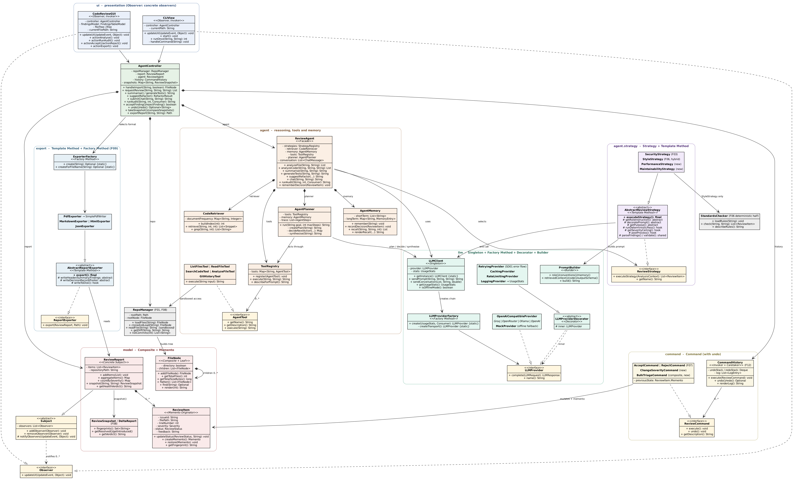
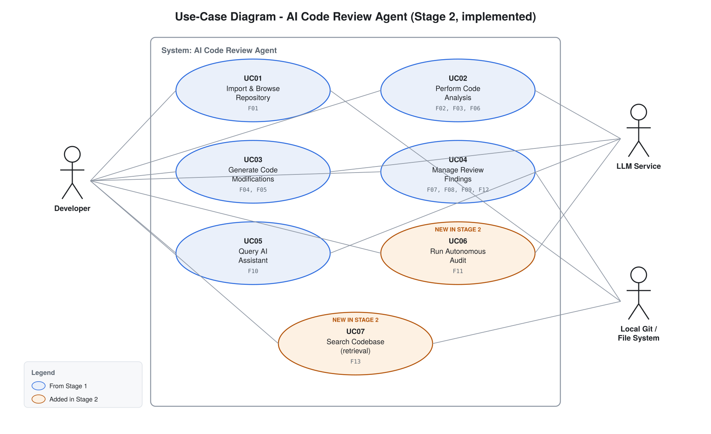
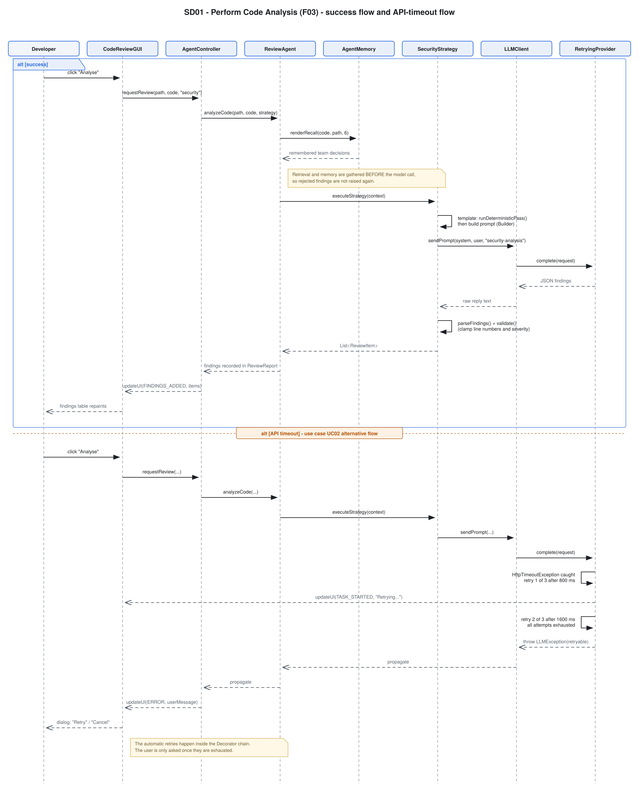
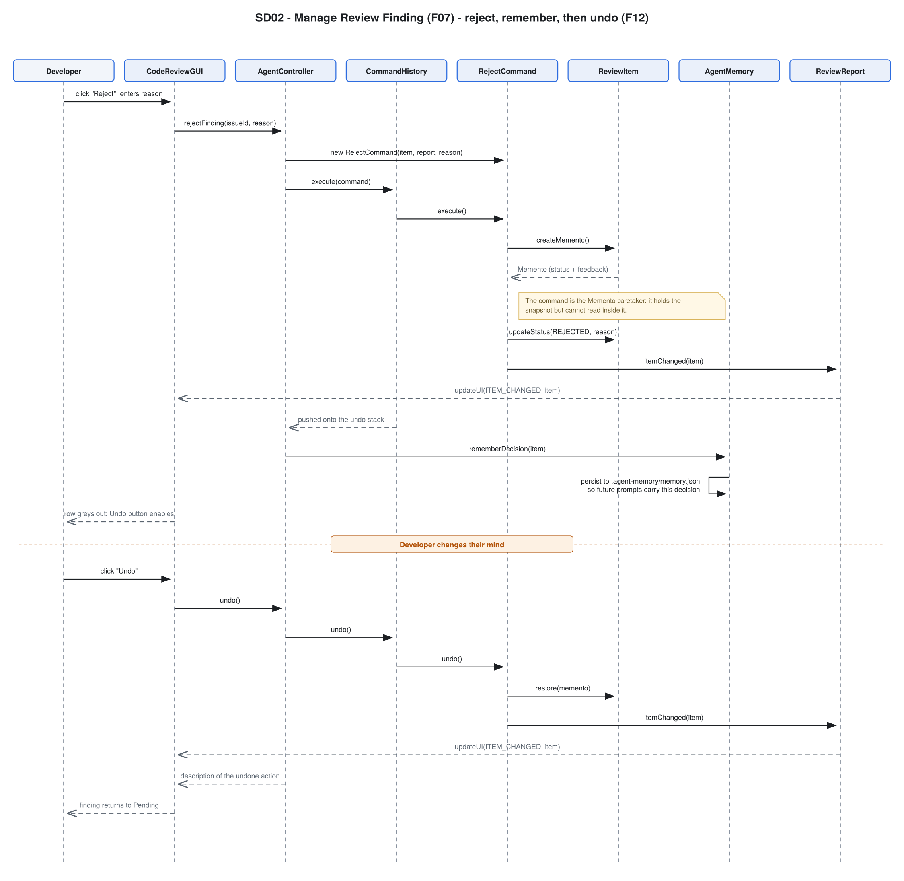
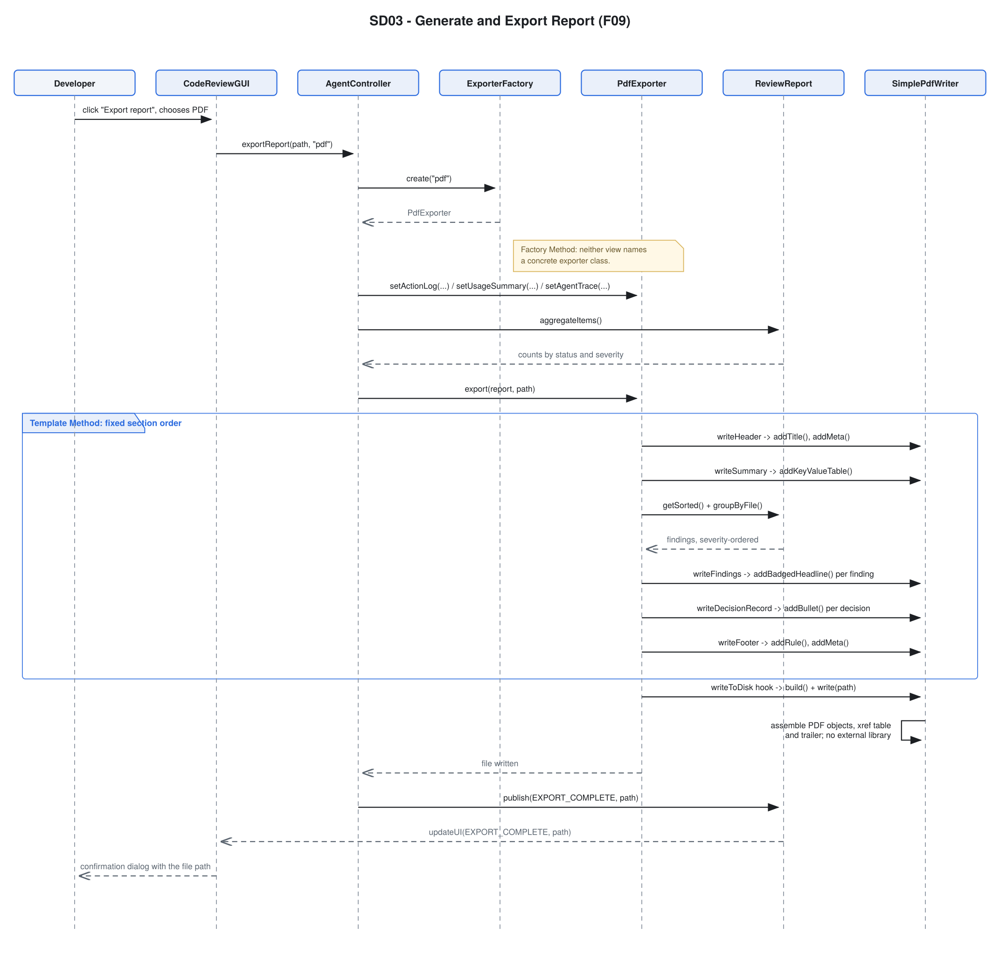
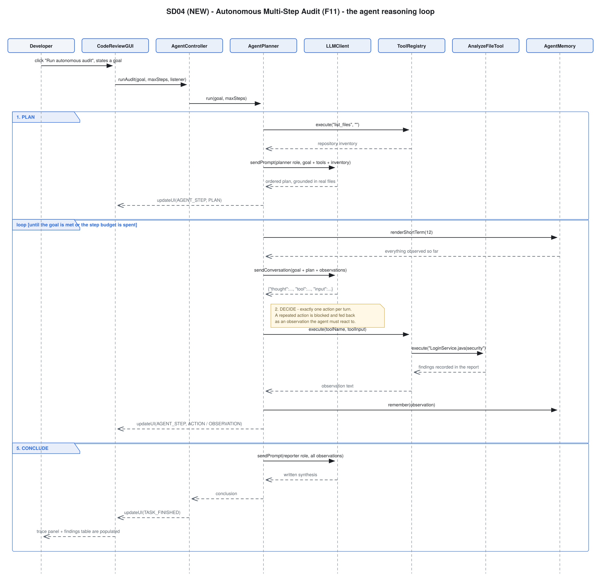

# Stage 2 Implementation Report

## AI Code Review Agent

**EECS3311 — Course Project, Stage 2 (AI Human Collaborative Implementation)**

| | |
|---|---|
| **Project** | AI Code Review Agent |
| **Repository** | `«FILL IN: https://github.com/<your-username>/<your-repo>»` |
| **Team member(s)** | `«FILL IN: name(s) and student number(s)»` |
| **Submission date** | 10 November 2026 |
| **Implementation period** | 20 October – 10 November 2026 |
| **Language / toolchain** | Java 17+ (compiled and tested on OpenJDK 21), Maven, zero runtime dependencies |
| **Entry point** | `com.eecs3311.codereview.app.Main` |

---

# 1. Project overview and implementation status

## 1.1 What the application is

The AI Code Review Agent is a desktop tool that reviews source code. A developer points it at
a repository; the agent indexes it, and can then explain code, detect defects and grade them
by severity, check a project coding standard, propose refactorings, write unit tests, answer
questions about the codebase in natural language, compare review results across two versions,
and export a report.

Beyond those request-response features, the agent can be given a goal in plain language and
left to pursue it on its own: it writes a plan, chooses which of its tools to invoke, reads
the code it decides is relevant, records findings, and writes a synthesis when it judges the
goal met.

## 1.2 Users

- **Software developers** reviewing their own work before opening a pull request.
- **QA engineers** looking for defects and missing test coverage.
- **Project leads** who need an exportable record of what was found and what the team decided
  about each finding.

## 1.3 AI and LLM integration

The system speaks the OpenAI `/chat/completions` protocol, so a single transport class covers
four backends, selected by one line of configuration:

| `LLM_PROVIDER` | Endpoint | Default model | Cost |
|---|---|---|---|
| `groq` *(default)* | `https://api.groq.com/openai/v1` | `llama-3.3-70b-versatile` | Free tier, no credit card |
| `openrouter` | `https://openrouter.ai/api/v1` | `google/gemma-4-31b-it:free` | Free tier |
| `ollama` | `http://localhost:11434/v1` | `llama3.1` | Free, runs locally |
| `openai` | `https://api.openai.com/v1` | `gpt-4o-mini` | Paid |

The model is reached through `LLMClient`, the single point of access, which wraps the
transport in four decorators: retrying, caching, rate limiting and usage logging.

**Where AI is actually used.** Each call is labelled with a purpose, and the logging decorator
accumulates tokens per purpose, so the system can report exactly what the model was used for:
`security-analysis`, `style-analysis`, `performance-analysis`, `maintainability-analysis`,
`code-summary`, `test-generation`, `refactor-suggestion`, `chat-assistant`, `delta-summary`,
`agent-planning`, `agent-decision` and `agent-synthesis`.

## 1.4 Why this qualifies as meaningful agent behaviour

The Stage 2 instructions state that forwarding a prompt to an LLM API and displaying the
response is insufficient. This implementation goes beyond that in six specific ways.

| Required capability | Where it is implemented | What actually happens |
|---|---|---|
| **Planning** | `AgentPlanner.createPlan` | The goal plus the real repository inventory are turned into an ordered plan naming actual files. The plan is grounded: the planner is shown what exists so it cannot propose reading files that are not there. |
| **Tool use** | `ToolRegistry`, five `AgentTool` implementations | The agent selects a tool by name and passes it a string argument. It never executes model output as code. Tool descriptions are generated from the registry, so the catalogue and the prompt cannot drift apart. |
| **Retrieval** | `CodeRetriever` | A TF-IDF-weighted index over the repository. Questions and analyses are answered against the few regions that actually matter, which is what lets the assistant work on a codebase far larger than any context window. |
| **Memory** | `AgentMemory` | Short-term: the run's observations, re-read before every decision. Long-term: the team's accept/reject decisions, persisted to `.agent-memory/memory.json` and recalled by relevance into later prompts. |
| **Decision making** | `AgentPlanner.decideNextAction` | One action per turn, chosen from everything observed so far. A repeated action is blocked and the block is fed back as an observation the agent must react to. A tool error becomes an observation rather than terminating the run. |
| **Multi-step execution** | `AgentPlanner.run` | Plan → decide → act → observe → repeat → conclude, bounded by a configurable step budget so a run always terminates. Every step is published to both views as it happens. |

A concrete example from a real run against `samples/demo-project`:

```
[step 1] PLAN         1. Call list_files to take an inventory of what the repository contains.
                      2. Call search_code to locate the code that handles credentials.
                      3. Call analyze_file with the security strategy on each file found.
[step 2] THOUGHT      Inventory the repository before choosing targets.
[step 2] ACTION       list_files
[step 2] OBSERVATION  Repository contains 3 source files ...
[step 3] THOUGHT      Locate the code most likely to handle credentials.
[step 3] ACTION       search_code: password authentication query
[step 3] OBSERVATION  Found 1 relevant region: LoginService.java (from line 26) ...
[step 5] ACTION       analyze_file: src/com/acme/shop/LoginService.java|security
[step 5] OBSERVATION  recorded 5 finding(s): [Critical] line 15: Credential hard-coded ...
[step 8] CONCLUSION   Audit complete
```

The agent is also **adaptive**. Rejecting a finding with a reason writes that decision to
long-term memory; the next analysis of related code carries an instruction derived from it:

> `- The team REJECTED the finding "Division without a zero guard", saying: sessionCount is validated by the caller. Do not report this again unless the circumstances clearly differ.`

## 1.5 Implementation status

**Fully implemented and working:** all thirteen features in section 2, both interfaces, ten
design patterns, the LLM integration with four interchangeable backends, and the autonomous
agent loop. All ten features proposed in Stage 1 are implemented; none were dropped.

**Verification:** 110 assertions pass in the dependency-free harness (`./build.sh --check`),
plus a JUnit 5 suite (`mvn test`). Both the GUI and the CLI have been exercised end-to-end,
and the real HTTP path has been verified against a mock OpenAI-compatible endpoint covering
success, malformed output, a 401 and a retried 503.

### Honest limitations

These are real and are not worked around:

1. **Output quality depends on the model.** On a free-tier 70B model, findings are good on
   obvious defect classes (injection, hard-coded secrets, swallowed exceptions, missing
   guards) and weaker on subtle cross-file logic errors. The system constrains the model
   — a fixed JSON schema, a severity ceiling per strategy, line-number validation — but it
   cannot make a small model reason better.

2. **Offline mode is deliberately limited.** With no API key the application still runs, using
   a built-in static analyser that derives findings from the code by regular expression. It is
   a fallback so the interface and the test suite work without a key; it does not reason, and
   both interfaces display an OFFLINE MODE banner whenever it is active. **Every AI-based
   feature in the demonstration videos is shown running against a real model.**

3. **Analysis is per-file.** The retriever supplies related snippets as context, but a defect
   that only exists in the interaction between three classes may be missed.

4. **F08 compares snapshots, not arbitrary commits automatically.** The user analyses one
   version, snapshots it, checks out the other, analyses it and snapshots that. Git provides
   the changed-file list; the tool does not check out commits on the user's behalf, which is
   deliberate — silently changing a developer's working tree would be unsafe.

5. **Refactorings are suggestions, never applied automatically.** The tool shows a
   side-by-side comparison and offers to copy the result. It does not write to source files.

6. **No authentication or multi-user support.** It is a single-user desktop tool.

---

# 2. Feature to implementation mapping

Every Stage 1 feature (F01–F10) is implemented. Three features (F11–F13) were added during
implementation; they are justified in section 4.

`«FILL IN: replace every “Video link” cell with your real link and timestamp.»`

---

## F01 — Repository Import and File Browsing

| Mapping field | Entry |
|---|---|
| **Feature ID and name** | F01 — Repository Import & File Browsing |
| **Stage 1 feature** | F01 |
| **Status** | Implemented (extended: Git cloning added) |
| **Implemented classes/files** | `repo/RepoManager.java` — all file-system and Git access, and the sandbox boundary; `model/FileNode.java` — the Composite tree; `app/AgentController.java` — orchestrates import; `ui/CodeReviewGUI.java` — JTree; `ui/CLIView.java` — `open`, `tree`, `files`, `cat` |
| **Key methods** | `RepoManager.loadFiles(String)`, `RepoManager.cloneAndLoad(String)`, `FileNode.getTotalFiles()`, `FileNode.flatten()`, `FileNode.find(String)`, `AgentController.handleImport(String, boolean)` |
| **Design patterns** | Composite |
| **Video link/timestamp** | `«FILL IN»` |

**Type:** Deterministic.

**How the classes collaborate.** The user chooses a folder in the GUI, or types `open <path>`
in the CLI. Either way the view calls `AgentController.handleImport`. The controller delegates
to `RepoManager.loadFiles`, which validates the path — reporting "does not exist", "is a file,
not a directory" or "permission denied" distinctly, which is the alternative flow use case
UC01 specifies — then walks the directory, skipping build output and dependency folders, and
builds a `FileNode` tree. The controller then clears the previous session, calls
`ReviewAgent.onRepositoryImported` (which loads the project's `.rules` file, builds the
retrieval index and attaches long-term memory to this repository), and publishes
`REPOSITORY_LOADED`. Both views receive that event and render the tree.

---

## F02 — Code Summarisation

| Mapping field | Entry |
|---|---|
| **Feature ID and name** | F02 — Code Summarisation |
| **Stage 1 feature** | F02 |
| **Status** | Implemented |
| **Implemented classes/files** | `agent/ReviewAgent.java` — Facade, builds the prompt; `llm/PromptBuilder.java` — prompt assembly; `llm/LLMClient.java` — the single model entry point; `ui/*` — invoke and display |
| **Key methods** | `ReviewAgent.summarise(String, String)`, `PromptBuilder.build()`, `LLMClient.sendPrompt(String, String, String)` |
| **Design patterns** | Facade, Singleton, Builder |
| **Video link/timestamp** | `«FILL IN»` |

**Type:** AI-based.

**How the classes collaborate.** The user selects a file, or highlights part of one, and
presses **Summarise** (`summarize` in the CLI). `AgentController.summarise` passes the
selection to `ReviewAgent.summarise`, which uses `PromptBuilder` to assemble a prompt asking
for four specific sections — purpose, how it works, dependencies and risks — rather than an
open-ended "summarise this", because an unstructured request produces a paraphrase of the
code instead of an explanation of it. `LLMClient` sends it; the reply is displayed in the AI
output panel. If the selection exceeds the context budget the builder truncates it with an
explicit marker and the user is told to select less, which is the error case F02 specifies.

---

## F03 — Issue Detection and Severity Categorisation

| Mapping field | Entry |
|---|---|
| **Feature ID and name** | F03 — Issue Detection & Severity Categorization |
| **Stage 1 feature** | F03 |
| **Status** | Implemented (extended: four strategies instead of one, severity is now a type-safe enum) |
| **Implemented classes/files** | `agent/strategy/ReviewStrategy.java`, `AbstractReviewStrategy.java`, `SecurityStrategy.java`, `StrategyRegistry.java`; `model/ReviewItem.java`, `model/Severity.java`, `model/ReviewReport.java` |
| **Key methods** | `AbstractReviewStrategy.executeStrategy(AnalysisContext)` *(final template method)*, `SecurityStrategy.decoratePrompt(...)`, `AbstractReviewStrategy.parseFindings(...)`, `AbstractReviewStrategy.validate(...)`, `ReviewReport.addItems(List)` |
| **Design patterns** | Strategy, Template Method, Facade, Singleton, Observer |
| **Video link/timestamp** | `«FILL IN»` |

**Type:** AI-based.

**How the classes collaborate.** Pressing **Analyse** calls
`AgentController.requestReview(path, code, strategyName)`. The controller delegates to
`ReviewAgent.analyzeCode`, which first assembles an `AnalysisContext` containing the code, the
project's conventions, the recalled team decisions from `AgentMemory`, and related snippets
from `CodeRetriever` — all gathered *before* any model call. `StrategyRegistry` resolves the
named strategy and `executeStrategy` runs the fixed seven-step template: reject empty input,
run the deterministic pre-pass, assemble the prompt, call the model once, parse the reply,
validate it, post-process. `parseFindings` tolerates the three ways models return JSON badly
(fenced, wrapped in prose, or buried in a wrapper object). `validate` corrects an out-of-range
line number to file-wide rather than discarding an otherwise valid finding, and clamps
severity to the strategy's ceiling. Findings are added to `ReviewReport`, which notifies both
views.

---

## F04 — Refactoring Suggestions

| Mapping field | Entry |
|---|---|
| **Feature ID and name** | F04 — Refactoring Suggestions |
| **Stage 1 feature** | F04 |
| **Status** | Implemented |
| **Implemented classes/files** | `agent/ReviewAgent.java`; `util/Diff.java` — LCS diff; `app/AgentController.java` — `RefactorResult`; `ui/CodeReviewGUI.java` — side-by-side dialog; `ui/CLIView.java` — text columns |
| **Key methods** | `ReviewAgent.suggestRefactor(String, String, ReviewItem)`, `AgentController.suggestRefactor(...)`, `Diff.compute(String, String)`, `Diff.renderSideBySide(...)`, `Diff.countChanges(...)` |
| **Design patterns** | Facade, Singleton, Builder |
| **Video link/timestamp** | `«FILL IN»` |

**Type:** AI-based.

**How the classes collaborate.** The user presses **Refactor**, or selects a finding and
presses **Fix this**. When a finding is given, its severity, title, description and line are
written into the prompt so the rewrite targets that specific defect. The model is required to
return the complete rewritten version in a fenced block followed by `WHY:` bullets. The
controller extracts the code block; if the reply contains no usable block it requests one more
time — the "malformed response, request regeneration" error case from Stage 1 — and fails with
a clear message if the second attempt also fails. `Diff.compute` runs a
longest-common-subsequence diff so an inserted line does not mark everything after it as
changed, and the GUI shows original and suggested side by side with the change counts.
**Nothing is written to the user's source files.**

---

## F05 — Test Generation Suggestion

| Mapping field | Entry |
|---|---|
| **Feature ID and name** | F05 — Test Generation Suggestion |
| **Stage 1 feature** | F05 |
| **Status** | Implemented |
| **Implemented classes/files** | `agent/ReviewAgent.java`; `llm/PromptBuilder.java`; `ui/*` |
| **Key methods** | `ReviewAgent.generateTests(String, String)`, `ReviewAgent.detectTestFramework(String)` |
| **Design patterns** | Facade, Singleton, Builder |
| **Video link/timestamp** | `«FILL IN»` |

**Type:** AI-based.

**How the classes collaborate.** `detectTestFramework` picks a framework from the file's
language — JUnit 5 for Java, pytest for Python, Jest for JavaScript and TypeScript, NUnit for
C# — or honours an explicit `TEST_FRAMEWORK` setting. This is the fallback use case UC03
describes for an unrecognised framework: the system defaults to the standard library framework
for the language rather than failing. The prompt requires coverage in a stated order (typical
case, each boundary, each failure path, null and empty input), one behaviour per test, real
assertions rather than placeholders, and a closing list of anything the model could not test
and why. The result is shown for the developer to copy; the tool does not write test files.

---

## F06 — Coding-Standard Checking

| Mapping field | Entry |
|---|---|
| **Feature ID and name** | F06 — Coding-Standard Checking |
| **Stage 1 feature** | F06 |
| **Status** | Implemented |
| **Implemented classes/files** | `repo/StandardsChecker.java` — the deterministic rule engine; `agent/strategy/StyleStrategy.java` — the hybrid strategy; `util/SourceText.java` — comment and string blanking; `samples/demo-project/.rules` — example rule file |
| **Key methods** | `StandardsChecker.loadRules(String)`, `StandardsChecker.check(String, String)`, `StandardsChecker.describeRules()`, `StyleStrategy.runDeterministicPass(AnalysisContext)` |
| **Design patterns** | Strategy, Template Method |
| **Video link/timestamp** | `«FILL IN»` |

**Type:** Hybrid — this is the clearest example of the split.

**How the classes collaborate.** On import, `RepoManager.readRulesFile` looks for `.rules`,
`.codereview-rules` or `CONVENTIONS.md`; if none is present the built-in defaults apply, which
is the "missing rule file" fallback F06 specifies. When the style strategy runs,
`StyleStrategy.runDeterministicPass` — the Template Method's deterministic hook — calls
`StandardsChecker.check`, which decides every rule that can be decided exactly: line length,
tabs, wildcard imports, unbraced conditionals, constant and type and method casing, parameter
count and method length. Only then is the model prompted, and `describeRules()` injects the
active rules together with an explicit instruction **not** to repeat them, so the two halves
do not both report the same violation. The model is asked only about judgement calls: whether
an identifier describes what it holds, whether a comment adds information, whether a class has
taken on a second responsibility.

Pattern matching runs over a comment-and-string-blanked copy of the file produced by
`SourceText.stripCommentsAndStrings`, with character positions preserved so line numbers stay
correct. Section 6.3 records the defect that made this necessary.

---

## F07 — Review Acceptance/Rejection and Human Feedback Capture

| Mapping field | Entry |
|---|---|
| **Feature ID and name** | F07 — Review Acceptance/Rejection & Human Feedback Capture |
| **Stage 1 feature** | F07 |
| **Status** | Implemented (extended: undo, re-grading and bulk triage added) |
| **Implemented classes/files** | `command/ReviewCommand.java`, `AcceptCommand.java`, `RejectCommand.java`, `ChangeSeverityCommand.java`, `BulkTriageCommand.java`, `CommandHistory.java`; `model/ReviewItem.java` (Memento); `agent/AgentMemory.java` |
| **Key methods** | `AcceptCommand.execute()/undo()`, `RejectCommand.execute()/undo()`, `ReviewItem.createMemento()`, `ReviewItem.restore(Memento)`, `CommandHistory.execute(ReviewCommand)`, `AgentMemory.recordDecision(ReviewItem)` |
| **Design patterns** | Command, Memento, Observer |
| **Video link/timestamp** | `«FILL IN»` |

**Type:** Deterministic.

**How the classes collaborate.** The GUI's Reject button and the CLI's `reject <ID> <reason>`
both reach `AgentController.rejectFinding`, which constructs a `RejectCommand` and hands it to
`CommandHistory.execute`. The command captures a memento of the finding's current triage
state, applies the change, and notifies `ReviewReport`, which pushes `ITEM_CHANGED` to every
view. The controller then calls `ReviewAgent.rememberDecision`, which writes the decision and
its reason into `AgentMemory` and persists it to `.agent-memory/memory.json`. That file is
what makes the agent adapt: the next analysis of related code recalls the decision by
relevance and includes it in the prompt as an instruction.

Sequence diagram **SD02** shows this flow including the undo path.

---

## F08 — Comparison of Reviews Across Versions

| Mapping field | Entry |
|---|---|
| **Feature ID and name** | F08 — Comparison of Reviews Across Versions |
| **Stage 1 feature** | F08 |
| **Status** | Implemented |
| **Implemented classes/files** | `model/ReviewSnapshot.java`, `model/DeltaReport.java`; `repo/RepoManager.java` — Git access; `agent/ReviewAgent.java` — the prose verdict |
| **Key methods** | `ReviewReport.snapshot(String, String)`, `DeltaReport` constructor, `ReviewItem.getFingerprint()`, `RepoManager.getDiff(String, String)`, `RepoManager.getChangedFiles(...)`, `AgentController.compareSnapshots(String, String)`, `ReviewAgent.summariseDelta(DeltaReport)` |
| **Design patterns** | — (Facade and Singleton are used for the AI half) |
| **Video link/timestamp** | `«FILL IN»` |

**Type:** Hybrid.

**How the classes collaborate.** The user analyses one version and saves a snapshot, then
analyses the other and saves a second. `DeltaReport` splits the two finding sets into
resolved, newly introduced and still-present, using `ReviewItem.getFingerprint()` — file,
category and headline, deliberately **excluding the line number**, so inserting a line above a
defect does not make the old issue look resolved and a new one invented. That arithmetic is
fully deterministic and is the authoritative result. If both snapshots carry commit hashes and
the folder is a Git working tree, `RepoManager.getDiff` adds the changed-file list. Only then
is the model asked, through `summariseDelta`, to interpret the direction of travel. If that
call fails the deterministic comparison is still shown, with a note that the AI assessment was
unavailable. An unknown commit produces a "Git Reference Error", the error case Stage 1
specified.

---

## F09 — Review-History Tracking and Report Generation

| Mapping field | Entry |
|---|---|
| **Feature ID and name** | F09 — Review-History Tracking & Report Generation |
| **Stage 1 feature** | F09 |
| **Status** | Implemented (extended: four formats instead of two) |
| **Implemented classes/files** | `export/ReportExporter.java`, `AbstractReportExporter.java`, `PdfExporter.java`, `MarkdownExporter.java`, `HtmlExporter.java`, `JsonExporter.java`, `ExporterFactory.java`, `SimplePdfWriter.java` |
| **Key methods** | `AbstractReportExporter.export(ReviewReport, Path)` *(final template method)*, `ReviewReport.aggregateItems()`, `PdfExporter.writeToDisk(String, Path)`, `SimplePdfWriter.build()`, `ExporterFactory.create(String)` |
| **Design patterns** | Template Method, Factory Method, Observer |
| **Video link/timestamp** | `«FILL IN»` |

**Type:** Deterministic.

**How the classes collaborate.** The user chooses a format and a destination.
`AgentController.exportReport` asks `ExporterFactory` for an exporter — inferring the format
from the file extension when none is named — attaches the action log, the measured token usage
and the agent's reasoning trace, and calls `export`. The template method fixes the document
order (header, summary, findings grouped by file, decision record, extra sections, footer) and
the file handling; each exporter supplies only the markup. `PdfExporter` overrides the
`writeToDisk` hook and drives `SimplePdfWriter`, a 200-line PDF generator written against the
PDF 1.4 format so the project needs no PDF library. A low-level write failure is translated
into the guidance UC04 asks for: check the file is not open elsewhere and that there is free
space. On success `EXPORT_COMPLETE` is published and both views report where the file went.

Sequence diagram **SD03** shows this flow.

---

## F10 — Natural Language AI Interface

| Mapping field | Entry |
|---|---|
| **Feature ID and name** | F10 — Natural Language AI Interface |
| **Stage 1 feature** | F10 |
| **Status** | Implemented (extended: retrieval-augmented, with cited sources) |
| **Implemented classes/files** | `agent/ReviewAgent.java` — conversation and context assembly; `agent/CodeRetriever.java` — retrieval; `model/ChatMessage.java`; `ui/CodeReviewGUI.java` — Assistant tab; `ui/CLIView.java` — `ask` |
| **Key methods** | `ReviewAgent.chat(String, String)`, `CodeRetriever.retrieve(String, int, int)`, `CodeRetriever.renderForPrompt(List, int)`, `ReviewAgent.trimConversation()` |
| **Design patterns** | Facade, Singleton |
| **Video link/timestamp** | `«FILL IN»` |

**Type:** AI-based.

**How the classes collaborate.** The question is **not** forwarded as typed. `CodeRetriever`
first scores every indexed file against it and returns the best-matching regions with their
line numbers; those are attached as context, along with the file currently open in the editor.
The running conversation is included so follow-up questions work, trimmed to the most recent
exchanges so a long session cannot overflow the context window. The system message restricts
the assistant to software topics, which is the "irrelevant prompt" error case Stage 1
specified. The reply is returned with a list of the files and line numbers that were
consulted, so the developer can check the answer.

---

## F11 — Autonomous Multi-Step Repository Audit  *(new in Stage 2)*

| Mapping field | Entry |
|---|---|
| **Feature ID and name** | F11 — Autonomous Multi-Step Repository Audit |
| **Stage 1 feature** | **New** |
| **Status** | Implemented |
| **Implemented classes/files** | `agent/AgentPlanner.java` — the reasoning loop; `agent/AgentStep.java` — one trace entry; `agent/tools/*` — `AgentTool`, `ToolRegistry`, `ListFilesTool`, `ReadFileTool`, `SearchCodeTool`, `AnalyzeFileTool`, `GitHistoryTool`, `AnalysisService`; `agent/AgentMemory.java` |
| **Key methods** | `AgentPlanner.run(String, int)`, `createPlan(String)`, `decideNextAction(...)`, `synthesise(String)`, `ToolRegistry.execute(String, String)`, `ToolRegistry.describeForPrompt()`, `AgentMemory.renderShortTerm(int)` |
| **Design patterns** | Facade, Singleton, Strategy *(via `analyze_file`)* |
| **Video link/timestamp** | `«FILL IN»` |

**Type:** AI-based.

**How the classes collaborate.** The user states a goal. `AgentPlanner.run` first calls
`list_files` and sends the goal, the tool catalogue and the real inventory to the model for a
plan. It then loops: it renders everything observed so far from `AgentMemory`, asks for exactly
one next action as JSON, executes the named tool through `ToolRegistry`, writes the result
back into memory, and repeats. Three design decisions make the loop robust rather than
fragile: an unknown tool name returns a readable error the agent can react to instead of
throwing; a repeated action is blocked and the block is fed back as an observation; and the
step budget guarantees termination. Each step is published as an `AgentStep`, so the GUI's
trace panel and the CLI stream the reasoning live. `analyze_file` is the only tool with a side
effect, which is why findings from an audit appear in the normal findings table for triage.

Sequence diagram **SD04** shows the full loop.

---

## F12 — Undo, Redo and Action History  *(new in Stage 2)*

| Mapping field | Entry |
|---|---|
| **Feature ID and name** | F12 — Undo / Redo and Action History |
| **Stage 1 feature** | **New** |
| **Status** | Implemented |
| **Implemented classes/files** | `command/CommandHistory.java`; `command/ChangeSeverityCommand.java`; `command/BulkTriageCommand.java`; `model/ReviewItem.java` (`Memento`) |
| **Key methods** | `CommandHistory.undo()`, `CommandHistory.redo()`, `CommandHistory.renderLog()`, `ReviewItem.createMemento()`, `ReviewItem.restore(Memento)`, `BulkTriageCommand.undo()` |
| **Design patterns** | Command, Memento |
| **Video link/timestamp** | `«FILL IN»` |

**Type:** Deterministic.

**How the classes collaborate.** `CommandHistory` holds an undo stack and a redo stack.
Executing a command pushes it and clears the redo stack; undo pops from one and pushes to the
other. Because each command captured a memento before acting, undo restores the exact prior
state — including a note set by an *earlier* command, not a blank default. A separate
append-only log records every action with a timestamp and survives undo, so the history stays
complete; that log is the "saved feedback log" F07 promised and is included in every exported
report. `BulkTriageCommand` groups many commands and undoes them in reverse order, so
"dismiss all Info findings" is a single undo step, which is what a user expects after one
click.

---

## F13 — Codebase Search and Retrieval  *(new in Stage 2)*

| Mapping field | Entry |
|---|---|
| **Feature ID and name** | F13 — Codebase Search & Retrieval |
| **Stage 1 feature** | **New** |
| **Status** | Implemented |
| **Implemented classes/files** | `agent/CodeRetriever.java`; `agent/tools/SearchCodeTool.java`; `ui/CLIView.java` — `search` |
| **Key methods** | `CodeRetriever.buildIndex(int)`, `retrieve(String, int, int)`, `scoreFile(...)`, `bestRegion(...)`, `renderForPrompt(List, int)`, `grep(String, int)` |
| **Design patterns** | — (used by Facade and by the agent's tools) |
| **Video link/timestamp** | `«FILL IN»` |

**Type:** Deterministic.

**How the classes collaborate.** On import, `buildIndex` reads every source file and records
document frequencies. A query is tokenised — splitting camelCase so "getUserPassword" also
matches "password" — and each file is scored with TF-IDF weighting, with extra weight for a
match in the file's path, because a developer asking about "authentication" usually wants
`AuthenticationService`. Within the best files, `bestRegion` finds the densest window of
matching lines and returns it with line numbers. This is the mechanism behind F10's context
and the agent's `search_code` tool, and it is also exposed directly as a user-facing search.

---

# 3. Implemented design patterns

Ten distinct patterns are implemented. The Stage 2 requirement is five; the five from Stage 1
are all present, and five more were added where implementation revealed a real need.

## 3.1 Singleton — `LLMClient`

**Design problem.** Twelve different call sites need the language model. If each created its
own client, the API credential would be duplicated across objects, there would be no single
usage total to report, the response cache would be fragmented, and per-minute rate limiting
would be impossible because no component would see the total outbound rate.

**Participants and roles.** `llm/LLMClient.java` is the Singleton. The nested private
`Holder` class is the lazy initialisation holder.

**Source files and methods.** `LLMClient.getInstance()`, `sendPrompt(...)`,
`sendConversation(...)`, `getUsageStats()`, `reloadConfiguration()`.

**How the implementation follows the pattern.** The constructor is private; the only access is
the static `getInstance()`. The instance is created by the initialisation-on-demand holder
idiom: the JVM guarantees the nested class is loaded lazily and exactly once, which makes
access thread-safe with no synchronisation on the common path. That matters because the Swing
event thread and the agent's background worker both call it.

**Why the pattern is useful here.** It is what makes `usage` able to report a single accurate
token total for the session, and what lets `RateLimitingProvider` see every outbound call.

**Match with Stage 1.** The pattern is the same; its **responsibilities are narrower**. Stage
1 gave `LLMClient` the fields `apiKey` and `instance` and the jobs of credential storage,
transport, rate limiting and prompt construction. In the implementation the credential lives
in `AppConfig` and is never held in a field that could be serialised or printed; transport
lives in `OpenAiCompatibleProvider`; rate limiting lives in a decorator. What remains is what
Singleton is actually for: controlled single access. This is recorded as change C1 in
section 4.

## 3.2 Strategy — the review strategies

**Design problem.** Issue detection, coding-standard checking, performance review and
maintainability review share one shape — take code, produce findings — but differ in what they
look for, how they are prompted, how severe their findings may be, and whether a deterministic
pre-pass applies. Expressed as conditionals inside the agent, every future analysis type would
concentrate in one growing method.

**Participants and roles.**

| Class | Role |
|---|---|
| `agent/strategy/ReviewStrategy.java` | Strategy (interface) |
| `agent/strategy/SecurityStrategy.java` | Concrete strategy (F03) |
| `agent/strategy/StyleStrategy.java` | Concrete strategy (F06, hybrid) |
| `agent/strategy/PerformanceStrategy.java` | Concrete strategy *(added)* |
| `agent/strategy/MaintainabilityStrategy.java` | Concrete strategy *(added)* |
| `agent/ReviewAgent.java` | Context — holds the selected strategy |
| `agent/strategy/StrategyRegistry.java` | Catalogue, resolves a strategy by name |

**Source files and methods.** `ReviewStrategy.executeStrategy(AnalysisContext)`,
`StrategyRegistry.find(String)`, `ReviewAgent.analyzeCode(...)`.

**How the implementation follows the pattern.** `ReviewAgent` holds a `ReviewStrategy`
reference and calls `executeStrategy` without knowing which concrete class it has. Selecting
"Security" or "Style" in either interface swaps the object, not a branch.

**Why it is useful here.** Adding `PerformanceStrategy` during implementation required one new
class and one registry line, with **no edit to `ReviewAgent`** — the extension the pattern
exists to make cheap.

**Match with Stage 1.** Matches, with two strategies added. Recorded as change C5.

## 3.3 Command — review actions

**Design problem.** Triage actions must be performable identically from two interfaces,
recorded in a log, and reversible. Handled inline in button callbacks, the GUI and the CLI
would inevitably drift apart and undo would be impossible.

**Participants and roles.**

| Class | Role |
|---|---|
| `command/ReviewCommand.java` | Command (interface) |
| `command/AcceptCommand.java`, `RejectCommand.java` | Concrete commands (F07) |
| `command/ChangeSeverityCommand.java` | Concrete command *(added)* |
| `command/BulkTriageCommand.java` | Composite concrete command *(added)* |
| `command/CommandHistory.java` | Invoker and Memento caretaker |
| `ui/CodeReviewGUI.java`, `ui/CLIView.java` | Clients that construct commands |
| `model/ReviewItem.java` | Receiver |

**Source files and methods.** `ReviewCommand.execute()`, `undo()`, `getDescription()`,
`CommandHistory.execute(ReviewCommand)`, `undo()`, `redo()`, `renderLog()`.

**How the implementation follows the pattern.** Each action is an object holding its receiver
and its parameters. `CommandHistory` invokes it without knowing what it does, which is what
lets undo, redo, logging and batching be written once for all four commands.

**Why it is useful here.** `ChangeSeverityCommand` was added late and inherited logging, undo
and batching for free.

**Match with Stage 1.** The pattern matches. The interface **gained `undo()`**, which Stage 1
did not have; this was required by new feature F12 and is recorded as change C3.

## 3.4 Observer — view updates

**Design problem.** Two independent views must reflect the same model, and the agent produces
results incrementally from a background thread. Polling would waste cycles and lag; a direct
reference from the model to a view would tie the model to Swing.

**Participants and roles.** `observer/Subject.java` (abstract subject),
`observer/Observer.java` (observer interface), `model/ReviewReport.java` (concrete subject),
`ui/CodeReviewGUI.java` and `ui/CLIView.java` (concrete observers).

**Source files and methods.** `Subject.addObserver(...)`, `notifyObservers(UpdateEvent, Object)`,
`Observer.updateUI(UpdateEvent, Object)`, `ReviewReport.addItems(List)`, `itemChanged(ReviewItem)`.

**How the implementation follows the pattern.** The subject holds observers in a
`CopyOnWriteArrayList` — the agent notifies from a worker thread while the event thread may be
registering views — and pushes typed events. One misbehaving view cannot stop the others: an
exception thrown by an observer is caught and logged, which the test suite verifies.

**Why it is useful here.** It is what lets the agent's reasoning stream live into the GUI trace
panel and the CLI simultaneously, with no coupling between them.

**Match with Stage 1.** Two differences, both recorded as change C2:
(a) Stage 1 declared `updateUI()` with no parameters, which would have forced every view to
query the subject to discover what changed; the implemented signature passes the event and its
payload so a view can repaint only the affected region.
(b) Stage 1 named `ReviewReport` as the subject; that is still true, and `Subject` was extracted
as an abstract base so the registry logic is written once.

## 3.5 Facade — `ReviewAgent`

**Design problem.** Behind the AI layer sit the Singleton client and its four decorators, the
strategy registry and four strategies, the deterministic standards checker, the retrieval
index, long-term memory, the tool registry and five tools, and the planner. A controller
orchestrating those directly would need to know the order in which memory is recalled, context
retrieved, rules loaded, prompts assembled and findings recorded — and both views would need
to know it identically.

**Participants and roles.** `agent/ReviewAgent.java` is the Facade. Subsystems: `LLMClient`,
`StrategyRegistry`, `StandardsChecker`, `CodeRetriever`, `AgentMemory`, `ToolRegistry`,
`AgentPlanner`. `app/AgentController.java` is the client.

**Source files and methods.** `analyzeFile(...)`, `analyzeCode(...)`, `summarise(...)`,
`generateTests(...)`, `suggestRefactor(...)`, `chat(...)`, `runAudit(...)`,
`onRepositoryImported()`.

**How the implementation follows the pattern.** The controller calls one method and receives a
result. Every facade method performs the same internal preparation — load conventions, recall
decisions, retrieve related code, then call the model.

**Why it is useful here.** It is what keeps `AgentController` readable and what guarantees the
GUI and CLI behave identically, since both go through the same six operations.

**Match with Stage 1.** The role matches. The **interface is wider**: Stage 1 declared
`analyzeCode()` and `generateTests()`; the implementation exposes six operations because F02,
F04, F08 and F10 each need a different prompt shape and return type. Forcing them through
`analyzeCode()` would have meant callers inspecting the returned text to work out what they
had been given. Recorded as change C4.

## 3.6 Composite — `FileNode`  *(added in Stage 2)*

**Design problem.** `RepoManager.loadFiles()` was specified in Stage 1 to return a flat
`List`. A flat list cannot express nesting, so the hierarchical file browser promised by F01
could not have been drawn from it, and statistics such as "how many files are under `src/`"
would have required the caller to re-derive the structure from path strings.

**Participants and roles.** `model/FileNode.java` plays both Component and, depending on
`isDirectory`, Leaf or Composite. Clients: the Swing `JTree` model, the CLI `tree` command,
`ListFilesTool`, and the report header.

**Source files and methods.** `getTotalFiles()`, `getTotalDirectories()`,
`getTotalSizeBytes()`, `flatten()`, `find(String)`, `render(int)`, `add(FileNode)`.

**How the implementation follows the pattern.** Every operation is uniform: a leaf answers for
itself, a directory recurses into its children and combines. Client code never asks whether a
node is a file. `add` on a leaf is ignored rather than throwing, which keeps the uniform
interface safe at the call site.

**Why it is useful here.** `ListFilesTool`, the GUI tree and the CLI renderer are each a few
lines because the traversal lives in the model. Recorded as change C6.

## 3.7 Factory Method — provider and exporter creation  *(added in Stage 2)*

**Design problem.** Two independent decisions are made at run time from configuration or user
input: which LLM backend to talk to, and which format to export. Without a factory, `LLMClient`
would contain a chain of conditionals naming four concrete transports plus the decorator
assembly order, and both views would name four concrete exporter classes.

**Participants and roles.** `llm/LLMProviderFactory.java` and `export/ExporterFactory.java`
are the creators; `OpenAiCompatibleProvider` and `MockProvider`, and the four exporters, are
the products.

**Source files and methods.** `LLMProviderFactory.create(UsageStats, Consumer)`,
`createTransport()`, `ExporterFactory.create(String)`, `createForFileName(String)`.

**How the implementation follows the pattern.** Client code asks for "a provider" or "an
exporter for pdf" and receives a fully configured object without naming a class. The provider
factory also encapsulates the decorator assembly order and documents why that order is correct
— logging outermost so cache hits count as served requests, caching above rate limiting so a
cached answer is not delayed, retrying innermost so a retried call is counted once.

**Why it is useful here.** Adding a backend or a format is a change in one file. Recorded as
change C7.

## 3.8 Template Method — analysis and export  *(added in Stage 2)*

**Design problem, two instances.** (a) Every analysis performs the same seven steps in the same
order, and only some of them vary; copied into each strategy, a fix to the JSON-repair logic
would have to be made four times. (b) Every export produces the same document sections in the
same order and only the markup differs.

**Participants and roles.**

| Class | Role |
|---|---|
| `agent/strategy/AbstractReviewStrategy.java` | Abstract class defining the algorithm |
| `SecurityStrategy`, `StyleStrategy`, `PerformanceStrategy`, `MaintainabilityStrategy` | Concrete classes supplying the varying steps |
| `export/AbstractReportExporter.java` | Abstract class defining the document order |
| `PdfExporter`, `MarkdownExporter`, `HtmlExporter`, `JsonExporter` | Concrete classes supplying markup |

**Source files and methods.** `AbstractReviewStrategy.executeStrategy(...)` is **final**;
abstract `getRoleInstruction()`, `decoratePrompt(...)`, `getPurpose()`; hooks
`runDeterministicPass(...)`, `getSeverityCeiling()`, `postProcess(...)`; shared
`parseFindings(...)`, `validate(...)`. `AbstractReportExporter.export(...)` is **final**;
abstract `writeHeader/Summary/Findings/DecisionRecord/Footer`; hooks `writeExtraSections`,
`writeToDisk`.

**How the implementation follows the pattern.** The template methods are `final`, so a subclass
can customise the steps but never their order. The hooks have useful defaults: only
`StyleStrategy` overrides the deterministic pass, and only `PdfExporter` overrides
`writeToDisk`.

**Why it is useful here.** `PdfExporter` is the clearest payoff: a format whose output is not
text at all still reuses the document order, the grouping, the sorting and the error handling,
by overriding one hook. Recorded as change C8.

**Relationship to Strategy.** They sit on the same class hierarchy but answer different
questions. Strategy decides *which* analysis runs; Template Method decides *how every* analysis
runs. They are counted separately because they address separate design problems.

## 3.9 Decorator — the provider chain  *(added in Stage 2)*

**Design problem.** Retrying, caching, rate limiting and usage accounting are four independent
concerns that apply to every model call. Inside `OpenAiCompatibleProvider` they would produce
one class with four reasons to change, and all four would have to be duplicated in the offline
provider.

**Participants and roles.**

| Class | Role |
|---|---|
| `llm/LLMProvider.java` | Component interface |
| `llm/OpenAiCompatibleProvider.java`, `llm/MockProvider.java` | Concrete components |
| `llm/decorator/LLMProviderDecorator.java` | Abstract decorator |
| `RetryingProvider` | Retries retryable failures with exponential backoff |
| `CachingProvider` | LRU cache of identical requests |
| `RateLimitingProvider` | Enforces a minimum gap between calls |
| `LoggingProvider` | Accumulates tokens and latency into `UsageStats` |

**Source files and methods.** `LLMProvider.complete(LLMRequest)` implemented by every layer;
`LLMProviderDecorator.inner`; `LLMProviderFactory.create(...)` composes the chain.

**How the implementation follows the pattern.** Each decorator both implements and wraps the
component interface, so a decorated provider is indistinguishable from a bare one at every call
site, and layers can be stacked in any order. The chain's name reports itself:
`Groq(llama-3.3-70b-versatile)+retry(3)+ratelimit+cache+logging`.

**Why it is useful here.** `RetryingProvider` is the implementation of the alternative flow in
sequence diagram SD01 and use case UC02: a timeout is retried automatically before the user
sees anything. `LoggingProvider` is what makes section 5 of this report quote measured token
counts rather than estimates. Recorded as change C9.

## 3.10 Memento — undo state  *(added in Stage 2)*

**Design problem.** Undo must restore a finding's exact prior triage state. Having each command
store the fields it changed would spread knowledge of `ReviewItem`'s internals across four
command classes, and adding a mutable field later would silently break undo for all of them.

**Participants and roles.** `model/ReviewItem` is the Originator; its nested
`ReviewItem.Memento` is the Memento; the command classes are Caretakers.

**Source files and methods.** `ReviewItem.createMemento()`, `ReviewItem.restore(Memento)`;
`previousState` in each command.

**How the implementation follows the pattern.** The memento's fields are private to the nested
class, so a command can hold it and hand it back but cannot read or alter the captured values.
The originator decides what state is worth capturing; adding a new mutable field means changing
`ReviewItem` only.

**Why it is useful here.** The test
`undoRestoresThePreviousCommandsStateNotTheDefault` verifies the property that matters: after
accepting with a note and then rejecting, undo restores the **accepted state with its original
note**, not a blank default. Recorded as change C10.

## 3.11 Builder — `PromptBuilder`  *(supporting)*

A prompt is assembled from up to eight independent parts, most call sites need only some, and
order matters. A constructor taking eight nullable strings would be unreadable.
`llm/PromptBuilder.java` lets each strategy name only the parts it needs, keeps the assembly
order in one place, and enforces the context-window guard rail in `build()`.

---

## 3.12 Updated UML class diagram



*Figure 1 — UML class diagram of the implemented system. Design-pattern roles are shown as
stereotypes. The diagram source is `docs/diagrams/class-diagram.dot`; regenerate it with
`dot -Tpng class-diagram.dot -o class-diagram.png`.*

### What changed from the Stage 1 class diagram

| Stage 1 | Implemented | Why |
|---|---|---|
| `RepoManager.loadFiles(): List` | returns `FileNode` (Composite) | A flat list cannot express a directory tree (C6) |
| `LLMClient` holds `apiKey` | credential lives in `AppConfig`; transport in `OpenAiCompatibleProvider` | A credential in a field is a credential that can be serialised or printed (C1) |
| `ReviewStrategy` with 2 implementations | 4 implementations plus `AbstractReviewStrategy` | Two analysis dimensions were missing; the shared algorithm was being duplicated (C5, C8) |
| `Observer.updateUI()` | `updateUI(UpdateEvent, Object)` | A no-argument signature forces views to query the subject for what changed (C2) |
| `ReviewCommand.execute()` | adds `undo()`, `getDescription()` | Required by F12 (C3) |
| `ReviewReport.exportPDF()` | `export` package with 4 exporters behind a factory | One method per format does not scale and duplicates the document structure (C7, C8) |
| `ReviewAgent` with 2 methods | 6 facade operations | Each feature needs a different prompt shape and return type (C4) |
| *(absent)* | `AgentPlanner`, `AgentMemory`, `CodeRetriever`, `ToolRegistry` + 5 tools | Stage 1 had no mechanism for agentic behaviour (C11) |
| *(absent)* | 4 decorators over `LLMProvider` | Retrying, caching, throttling and metering are independent concerns (C9) |

## 3.13 Updated use-case diagram



*Figure 2 — Use-case diagram. UC01–UC05 are from Stage 1; UC06 and UC07 are new. A third
actor, the local Git repository / file system, is shown because F01, F08 and F13 depend on it.*

| Use case | Features | Change |
|---|---|---|
| UC01 Import & Browse Repository | F01 | Unchanged |
| UC02 Perform Code Analysis | F02, F03, F06 | Unchanged |
| UC03 Generate Code Modifications | F04, F05 | Unchanged |
| UC04 Manage Review Findings | F07, F08, F09, **F12** | Extended with undo |
| UC05 Query AI Assistant | F10 | Unchanged |
| **UC06 Run Autonomous Audit** | **F11** | **New** |
| **UC07 Search Codebase** | **F13** | **New** |

### UC06 — Run Autonomous Audit *(new)*

- **Actors:** Developer, LLM Service
- **Goal:** Have the agent independently examine a repository against a stated goal and report
  what it finds.
- **Preconditions:** A repository is imported and indexed; an API key is configured.
- **Trigger:** The user presses **Run autonomous audit** or types `audit <goal>`.
- **Main success scenario:**
  1. The user states a goal in plain language.
  2. The system takes an inventory of the repository and asks the model for a plan grounded in
     the files that exist.
  3. The system repeatedly asks the model for one next action, executes the named tool, and
     records the observation, until the goal is met or the step budget is spent.
  4. Findings produced by the analysis tool are recorded in the session report.
  5. The system asks the model for a closing synthesis over everything observed.
  6. The reasoning trace and the findings are presented for triage.
- **Alternative flows:** A tool returns an error, which becomes an observation the agent reacts
  to; a repeated action is blocked and reported back; the user cancels, and findings recorded
  so far are kept.
- **Postconditions:** The report holds the findings; the trace is available for export.

### UC07 — Search Codebase *(new)*

- **Actors:** Developer
- **Goal:** Locate the regions of a repository relevant to a topic.
- **Trigger:** The user types `search <keywords>`, or the agent invokes `search_code`.
- **Main success scenario:** The query is tokenised and scored against the index; the
  best-matching regions are returned with file paths and line numbers.
- **Alternative flows:** Nothing matches, and the user is told so and offered the file list.

## 3.14 Updated sequence diagrams



*Figure 3 — SD01, Perform Code Analysis. Updated from Stage 1: memory recall and retrieval now
precede the model call, the strategy is a separate participant, and the timeout flow shows the
automatic retries inside the decorator chain before the user is offered a retry.*



*Figure 4 — SD02, Manage Review Finding. Updated: the command captures a memento before
acting, `CommandHistory` is the invoker, the decision is written to agent memory, and the undo
path is shown.*



*Figure 5 — SD03, Generate and Export Report. Updated: `ExporterFactory` selects the exporter
and the template method's fixed section order is shown explicitly.*



*Figure 6 — SD04, Autonomous Multi-Step Audit. New in Stage 2; there was no Stage 1 equivalent
because the agent loop did not exist.*

---

# 4. Changes and rationale

Consolidated record in the form **Original design → Implemented change → Reason → Impact**.

## 4.1 Feature changes

### C-F1 — F08 comparison scope narrowed

- **Original design (F08).** "User selects two commits in the repository browser to compare";
  the system fetches diffs and compares historical data.
- **Implemented change.** The user analyses a version, saves a labelled snapshot, switches
  version themselves, analyses and snapshots again, then compares the two snapshots. Git
  supplies the changed-file list and the commit list.
- **Reason.** Checking out a commit silently rewrites the developer's working tree, which can
  destroy uncommitted work. The tool does not take that liberty. The comparison logic — the
  valuable part — is unchanged and fully implemented.
- **How it addresses the original need.** The user still gets exactly the delta report F08
  specified: resolved, newly introduced and still-present findings, with an AI verdict on the
  direction of travel.
- **Affected artefacts.** UC04; `ReviewSnapshot`, `DeltaReport`, `RepoManager.getDiff`,
  `AgentController.compareSnapshots`; no pattern change.

### C-F2 — F06 split made explicit

- **Original design (F06).** "Hybrid (deterministic parsing + AI interpretation of vague
  rules)".
- **Implemented change.** The split is enforced structurally: `StandardsChecker` decides every
  mechanical rule, and the model's prompt carries the active rules **plus an instruction not to
  report them**.
- **Reason.** Without the exclusion both halves report the same violation, producing duplicate
  findings that each need triaging separately. This was observed during testing and fixed.
- **Impact.** `StyleStrategy` overrides the Template Method's deterministic hook; verified by
  the tests `conforming code produces no findings` and `a rule turned off in .rules does not
  fire`.

### C-F3 — F09 extended to four formats

- **Original design (F09).** Export to PDF or Markdown.
- **Implemented change.** PDF, Markdown, HTML and JSON.
- **Reason.** HTML is the format a report is actually shared in; JSON makes the tool usable
  from a CI pipeline and lets a session be reloaded. Both were nearly free once the Template
  Method base existed.
- **Impact.** Four exporters behind `ExporterFactory`; adds Factory Method and the second
  Template Method instance.

### C-F4 — F11 added: Autonomous Multi-Step Repository Audit

- **Original design.** No equivalent. Stage 1 described the agent's capabilities but every
  feature was a single request-response call.
- **Implemented change.** A full plan → decide → act → observe → conclude loop with five tools,
  short- and long-term memory, loop protection and a step budget.
- **Reason.** The Stage 2 instructions require reasoning, planning, tool use, retrieval, memory,
  decision making or multi-step execution, and state that forwarding a prompt is insufficient.
  Reviewing the Stage 1 design against that requirement showed that none of the ten features
  individually satisfied it. F11 is the feature that makes the system an agent.
- **Scope impact.** This is the largest addition. It introduced `agent/AgentPlanner`,
  `AgentStep`, `AgentMemory` and the whole `agent/tools` package.
- **Affected artefacts.** New UC06; new SD04; `AgentPlanner`, `AgentMemory`, `ToolRegistry`,
  five tools, `AnalysisService`; uses Facade, Singleton and Strategy.

### C-F5 — F12 added: Undo, Redo and Action History

- **Original design.** Stage 1's `ReviewCommand` declared only `execute()`, and listed "undo
  operations" as a *motivation* for the Command pattern without a feature to deliver it.
- **Implemented change.** `undo()` and `getDescription()` added to the interface;
  `CommandHistory` with undo and redo stacks plus an append-only log; `BulkTriageCommand` so a
  batch undoes as one step.
- **Reason.** Rejecting a finding writes a permanent decision into agent memory. Without undo,
  a misclick teaches the agent something wrong with no way to correct it. The pattern was
  already in place; the feature was two methods away.
- **Impact.** Adds Memento; extends UC04 and SD02.

### C-F6 — F13 added: Codebase Search and Retrieval

- **Original design.** F10 described sending "chat text + code context" to the model, with no
  mechanism for choosing that context.
- **Implemented change.** `CodeRetriever`, a TF-IDF index over the repository, exposed as a
  user-facing search, as the agent's `search_code` tool, and as the context source for F10 and
  for every analysis.
- **Reason.** A codebase does not fit in a context window. Without retrieval, F10 could only
  answer about the file currently open, which is not what "ask about the codebase" means.
- **Impact.** New UC07; `CodeRetriever`, `SearchCodeTool`; makes F10 substantially better.

### C-F7 — Four analysis strategies instead of two

- **Original design.** `SecurityStrategy` and `StyleStrategy`.
- **Implemented change.** Added `PerformanceStrategy` and `MaintainabilityStrategy`, plus a
  "Full review" action that runs all four.
- **Reason.** Security and style covered correctness and formatting but left algorithmic cost
  and structural design unexamined — and F04 and F05 produce noticeably better output when a
  maintainability pass has run first.
- **Impact.** Two new classes, two registry lines, **no change to `ReviewAgent`**.

### C-F8 — No feature was removed

All ten Stage 1 features are implemented. Nothing was silently dropped.

## 4.2 Design pattern changes

| ID | Original pattern | Implemented | Participating classes and roles | Design problem addressed | Why appropriate / impact |
|---|---|---|---|---|---|
| **C1** | Singleton with transport, credentials and rate limiting | Singleton with *access only* | `LLMClient` (Singleton); credential moved to `AppConfig`; transport to `OpenAiCompatibleProvider`; throttling to `RateLimitingProvider` | One class had four reasons to change, and held a credential in a field | Single Responsibility restored; the credential can no longer be serialised or printed; the Singleton still gives one usage total and one cache |
| **C2** | Observer, `updateUI()` | Observer, `updateUI(UpdateEvent, Object)`; `Subject` extracted | `Subject` (abstract), `Observer`, `ReviewReport` (concrete subject), two views | A no-argument callback forces each view to query the subject to discover what changed | Views repaint only the affected region; the agent can stream individual steps; registry logic written once |
| **C3** | Command, `execute()` only | Command with `execute()`, `undo()`, `getDescription()` | `ReviewCommand`, 4 concrete commands, `CommandHistory` (Invoker) | Triage decisions were irreversible and unlogged | Enables F12; the log is the feedback record F07 promised |
| **C4** | Facade with 2 operations | Facade with 6 operations | `ReviewAgent` (Facade) over 7 subsystems | Four features need different prompt shapes and return types | Callers no longer inspect returned text to discover what they received |
| **C5** | Strategy, 2 strategies | Strategy, 4 strategies | `ReviewStrategy` + 4 concrete + `StrategyRegistry` | Two analysis dimensions were missing | Each addition cost one class and one line; no agent edit |
| **C6** | *(none — flat `List`)* | **Composite** | `FileNode` (Component, Leaf, Composite) | A flat list cannot express a directory tree or answer subtree questions | F01's hierarchical browser becomes possible; four clients share one traversal |
| **C7** | *(none)* | **Factory Method** ×2 | `LLMProviderFactory`, `ExporterFactory` | Run-time selection of a backend and an output format | New backend or format is a one-file change; decorator assembly order is encapsulated and documented |
| **C8** | *(none)* | **Template Method** ×2 | `AbstractReviewStrategy`, `AbstractReportExporter` | The same seven analysis steps, and the same five document sections, were being duplicated | A fix to JSON repair or to export error handling is made once; `PdfExporter` reuses the whole structure by overriding one hook |
| **C9** | *(none)* | **Decorator** | `LLMProviderDecorator` + Retrying, Caching, RateLimiting, Logging | Four independent cross-cutting concerns over every model call | Each is written once, tested in isolation, and applies to the offline provider too; implements SD01's retry flow |
| **C10** | *(none)* | **Memento** | `ReviewItem` (Originator), `ReviewItem.Memento`, commands (Caretakers) | Undo must restore exact prior state without exposing internals | Four command classes need no knowledge of `ReviewItem`'s fields; a new mutable field is handled in one place |
| **C11** | *(none)* | Agent loop *(architecture, not a GoF pattern)* | `AgentPlanner`, `AgentMemory`, `ToolRegistry`, 5 `AgentTool`s | Stage 1 had no mechanism for planning, tool use or memory | Delivers the "meaningful agent behaviour" requirement |

**Effect on the architecture.** Stage 1's architecture was a three-layer pipeline: views →
controller → agent → LLM. The implementation keeps that spine and adds two things. First, a
**decorated transport**, so cross-cutting concerns live outside the business logic. Second, an
**agentic layer** (planner, tools, memory, retrieval) between the facade and the model, which
is what turns a sequence of API calls into an agent. Neither addition changed the direction of
any existing dependency.

---

# 5. AI tools and collaboration log

`«FILL IN: adjust the rows below to match the tools you actually used, and enter the real
token and money costs. Where to find them: Claude.ai → Settings → Usage; Cursor → Settings →
Usage; GitHub Copilot → your GitHub billing page. If a tool was on a flat-rate subscription,
state the subscription cost and the period, and say that per-token figures are not exposed.»`

## 5.1 Tools used

| Tool / platform | LLM / model | What it was used for | Token cost | Money cost |
|---|---|---|---|---|
| `«e.g. Claude (claude.ai)»` | `«e.g. Claude Opus 4.5»` | Architecture of the agent loop; `AgentPlanner`, `AgentMemory`, `CodeRetriever`; the decorator chain; `SimplePdfWriter`; test design; this report | `«FILL IN»` | `«FILL IN»` |
| `«e.g. GitHub Copilot»` | `«e.g. GPT-4.1»` | In-editor completion while writing the Swing UI and the CLI command dispatch | `«not exposed»` | `«e.g. $10/month student plan»` |
| `«add or remove rows»` | | | | |

**Total measured cost:** `«FILL IN»`

## 5.2 Runtime model usage (measured by the application itself)

The application meters its own LLM usage through `LoggingProvider` and `UsageStats`, so the
figures below are measured rather than estimated. Reproduce them with the CLI `usage` command
or **Report → Session usage and cost** in the GUI.

```
MODEL USAGE THIS SESSION
  Requests sent      : «FILL IN»
  Served from cache  : «FILL IN»
  Failed requests    : «FILL IN»
  Prompt tokens      : «FILL IN»
  Completion tokens  : «FILL IN»
  Total tokens       : «FILL IN»
  Average latency    : «FILL IN» ms
  Breakdown by feature:
    - security-analysis:  «n» call(s), «n» tokens
    - chat-assistant:     «n» call(s), «n» tokens
    - agent-planning:     «n» call(s), «n» tokens
    ...
```

**Runtime money cost:** the default provider (Groq, `llama-3.3-70b-versatile`) is free at the
tier used — 30 requests/minute and 14,400 requests/day, with no credit card required — so the
runtime inference cost of this project was **$0.00**.

## 5.3 Representative interactions

`«FILL IN: replace these with two or three of your own real exchanges — the prompt you gave,
what the tool produced, and what you changed. Keep them short. The three below are the shape
the marker is looking for: what was asked, what came back, and what human judgement was
applied on top.»`

**Interaction 1 — architecture**

> **Prompt:** "My Stage 1 design has a ReviewAgent that calls an LLM for each feature. The
> Stage 2 brief says forwarding a prompt is not enough. What is the smallest change that makes
> this a real agent?"
>
> **Response:** Proposed a plan–act–observe loop with a tool registry, and warned that the
> loop must be bounded and must handle repeated actions.
>
> **What I changed:** I kept the loop but rejected the first suggestion of letting the model
> emit arbitrary shell commands, which would have been unsafe. I restricted it to five named
> tools returning strings, and added the sandbox check in `RepoManager.resolveInsideRoot` so a
> path like `../../etc/passwd` is refused.

**Interaction 2 — a defect the tool introduced**

> **Prompt:** "Write a regex to find the class name in a Java file."
>
> **Response:** `(class|interface|enum|record)\s+(\w+)`
>
> **What I changed:** This matched the word "class" inside comments, so a file documented as
> "This class is intentionally small" was reported as declaring a type named `is`. I wrote
> `SourceText.stripCommentsAndStrings`, which blanks comments and string literals while
> preserving character positions so line numbers stay correct, and added a regression test.
> Recorded as defect D1 in section 6.3.

**Interaction 3 — a suggestion I rejected**

> **Prompt:** "How should I generate the PDF report?"
>
> **Response:** Recommended adding Apache PDFBox as a Maven dependency.
>
> **What I changed:** I rejected it. The project is deliberately dependency-free so it builds
> on any machine with only a JDK, which matters for a marker checking out the repository. I
> wrote `SimplePdfWriter` (~200 lines) against the PDF 1.4 format instead, and verified the
> output opens correctly and that its text extracts.

## 5.4 Human responsibility

Every file was read and reviewed before being committed. Specific judgements that were mine
and not the tool's:

- Restricting the agent to a fixed tool catalogue rather than letting it emit executable
  commands, and sandboxing file access to the imported repository.
- Rejecting the PDF library dependency in favour of a self-contained writer.
- Deciding that `getFingerprint()` must exclude the line number, so F08 does not report a
  shifted defect as "resolved plus newly introduced".
- Deciding that the offline fallback must be visibly labelled rather than silently degraded,
  and that it must derive findings from the code rather than return canned text.
- Writing the verification harness and the regression tests for each defect in section 6.3.

---

# 6. Development and verification summary

## 6.1 Weekly commit summary

`«FILL IN: paste your real commit links. Use the GitHub URL form
https://github.com/<user>/<repo>/commit/<sha>. You can list the commits for a period with:
git log --since=2026-11-03 --until=2026-11-10 --pretty=format:'%h  %ad  %s' --date=short »`

| Period | Dates (Toronto time) | Minimum | Commits made | Links |
|---|---|---|---|---|
| 1 | 20–26 October 2026 | 5 | `«FILL IN»` | `«FILL IN»` |
| 2 | 27 October – 2 November 2026 | 5 | `«FILL IN»` | `«FILL IN»` |
| 3 | 3–9 November 2026 | 5 | `«FILL IN»` | `«FILL IN»` |

**Commit log for this submission**

`«FILL IN: paste the output of
git log --pretty=format:'%h  %ad  %s' --date=short »`

## 6.2 Checks performed

| # | Check | Method | Result |
|---|---|---|---|
| 1 | Unit and integration tests | `mvn test` — JUnit 5 across `FileNodeTest`, `CommandHistoryTest`, `JsonTest`, `StandardsCheckerTest`, `ObserverAndReportTest`, `ExporterAndDiffTest`, `LlmLayerTest` | Pass |
| 2 | Dependency-free verification | `./build.sh --check` — 110 assertions across all ten patterns plus a full end-to-end run | 110 passed, 0 failed |
| 3 | Clean build from scratch | `rm -rf target && ./build.sh` on a clean checkout | Compiles with no warnings |
| 4 | Real HTTP path | Ran the application against a local OpenAI-compatible mock endpoint covering success, fenced/prose-wrapped JSON, an out-of-range line number, a 401 and a retried 503 | All handled correctly; the API key appears only in the `Authorization` header |
| 5 | GUI exercised end-to-end | Imported a repository, opened a file, ran an analysis, selected a finding, ran an autonomous audit, triaged, undid, exported | All panels update correctly; the window never blocks during a model call |
| 6 | CLI exercised end-to-end | Every command in `help`, including one-shot `--command` mode | All commands behave as documented |
| 7 | Export integrity | Exported all four formats; verified the PDF opens and its text extracts, the HTML is well-formed and escapes markup, the JSON re-parses | All four valid |
| 8 | Offline mode | Ran with no `.env` present | Starts, warns clearly in both interfaces, all non-AI features work |
| 9 | Secret hygiene | `git status` after creating `.env`; searched the tree for key-shaped strings; checked every log, report and screenshot | No credential is tracked, logged or displayed unredacted |
| 10 | Error paths | Invalid path, path that is a file, non-Git folder for F08, unknown commit, unknown export format, empty selection, unknown strategy name | Each produces a specific, actionable message |

## 6.3 Important defects found and corrected

| ID | Defect | How it was found | Fix | Regression test |
|---|---|---|---|---|
| **D1** | The type-declaration regex matched the word "class" inside comments, so a file documented as "This class is intentionally small" was reported as declaring a type named `is` | Running `summarize` on `PriceCalculator.java` during manual testing | Added `util/SourceText.stripCommentsAndStrings`, which blanks comments and string literals while preserving character positions so line numbers stay correct; all structural matching now runs on that view | `prose containing 'class' is not read as a declaration` |
| **D2** | Constructors were reported as badly named methods, because a constructor is required to start with a capital | Running the style strategy on `LoginService.java` | `StandardsChecker` now collects the type names declared in the file first and excludes a method whose name matches one | `constructors are not flagged as badly named methods` |
| **D3** | The deterministic rule engine and the AI half both reported the same style violations, producing duplicate findings that each needed triaging | Comparing the finding list against the file by hand | The model's prompt now carries the active rules plus an explicit instruction not to report them; the offline analyser's style pass was narrowed to the judgement-only checks | `conforming code produces no findings` |
| **D4** | Re-analysing a file that the autonomous audit had also analysed produced every finding twice under different identifiers, so triaging one left the other outstanding | Running an analysis and then an audit over the same file | `ReviewReport` now discards a finding whose file, category, headline **and line number** all match an existing one | `re-adding an identical finding is a no-op` |
| **D5** | The prose verdict for the F08 comparison was routed to the summarisation handler, because the purpose label `delta-summary` contains the substring `summar` | Running `compare` in offline mode and reading the output | Reordered the dispatch so the more specific label is tested first | Covered by the `compare` path in the end-to-end check |
| **D6** | Exported reports contained absolute file paths, which is noise for a reader and leaks the directory layout of the machine the review ran on | Reading a generated PDF | `AbstractReportExporter` now relativises every path against the repository root | `exported paths are relative, not absolute` |
| **D7** | Commas inside generic type arguments were counted as parameter separators, so `go(Map<String, List<Integer>> a, int b)` was reported as taking three parameters | Writing the test for the parameter-count rule | Parameter counting now tracks bracket depth | `generic type arguments do not inflate the parameter count` |
| **D8** | The findings table and file tree were empty when the GUI was constructed after a repository had already been imported, because observers only receive events published after they register | Launching the GUI with `--repo` | The window now pulls the current state on construction instead of waiting for an event | Covered by check 5 |

## 6.4 Remaining limitations

Repeated from section 1.5 for completeness: output quality is bounded by the model; offline
mode is a deliberately limited fallback and is always labelled; analysis is per-file with
retrieved context rather than whole-program; F08 compares snapshots rather than checking out
commits; refactorings are never applied automatically; there is no multi-user support.

**Deferred to Stage 3, as the Project Instructions specify:** full deterministic test
coverage, and KUMA agent validation. Stage 2 required a working implementation and basic
verification, which checks 1–10 above provide.

---

# 7. Demonstration index

`«FILL IN: record your videos, then replace every link below. Each segment must show the
feature ID and name, how it is invoked, the input, the running application, the output, and
where AI is involved. Show both the GUI and the CLI across the set. Make sure the links are
viewable without an access request — on Google Drive set "Anyone with the link → Viewer" and
test it in a private browsing window. Do not let your API key appear on screen; the
application already redacts it to **** plus the last four characters.»`

| Feature | Name | Interface shown | Video link | Timestamp |
|---|---|---|---|---|
| F01 | Repository Import & File Browsing | GUI + CLI | `«FILL IN»` | `«00:00»` |
| F02 | Code Summarisation | GUI | `«FILL IN»` | `«00:00»` |
| F03 | Issue Detection & Severity Categorisation | GUI | `«FILL IN»` | `«00:00»` |
| F04 | Refactoring Suggestions (side-by-side) | GUI | `«FILL IN»` | `«00:00»` |
| F05 | Test Generation Suggestion | GUI | `«FILL IN»` | `«00:00»` |
| F06 | Coding-Standard Checking (hybrid) | CLI | `«FILL IN»` | `«00:00»` |
| F07 | Accept / Reject & Feedback Capture | GUI | `«FILL IN»` | `«00:00»` |
| F08 | Comparison Across Versions | CLI | `«FILL IN»` | `«00:00»` |
| F09 | Report Generation (PDF/MD/HTML/JSON) | GUI + CLI | `«FILL IN»` | `«00:00»` |
| F10 | Natural Language AI Interface | GUI | `«FILL IN»` | `«00:00»` |
| F11 | Autonomous Multi-Step Audit | GUI + CLI | `«FILL IN»` | `«00:00»` |
| F12 | Undo / Redo & Action History | GUI | `«FILL IN»` | `«00:00»` |
| F13 | Codebase Search & Retrieval | CLI | `«FILL IN»` | `«00:00»` |
| — | Error handling: API timeout and retry | GUI | `«FILL IN»` | `«00:00»` |
| — | Error handling: invalid repository path | CLI | `«FILL IN»` | `«00:00»` |
| — | Offline-mode warning and local key configuration | GUI | `«FILL IN»` | `«00:00»` |

---

## Traceability summary

A reviewer can follow any requirement end to end:

**Stage 1 requirement → implemented feature → participating classes and methods → design
patterns → running demonstration**

For example, F03: Stage 1 feature F03 → section 2's F03 mapping →
`SecurityStrategy.decoratePrompt`, `AbstractReviewStrategy.executeStrategy`,
`ReviewReport.addItems` → Strategy, Template Method, Facade, Singleton, Observer → section 3.2
and 3.8 → sequence diagram SD01 → the F03 row of section 7.
